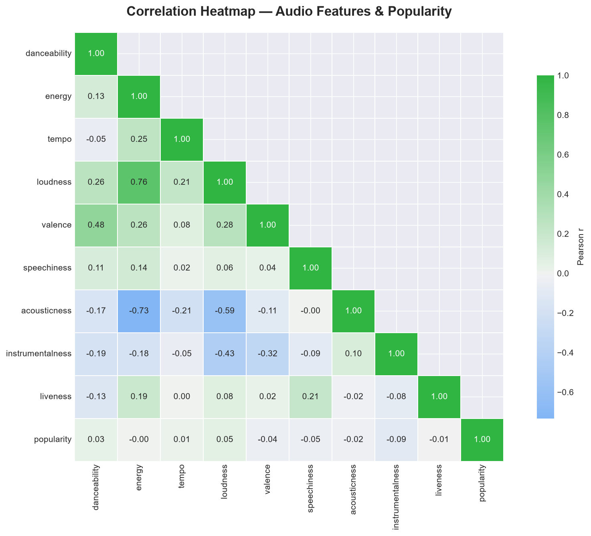
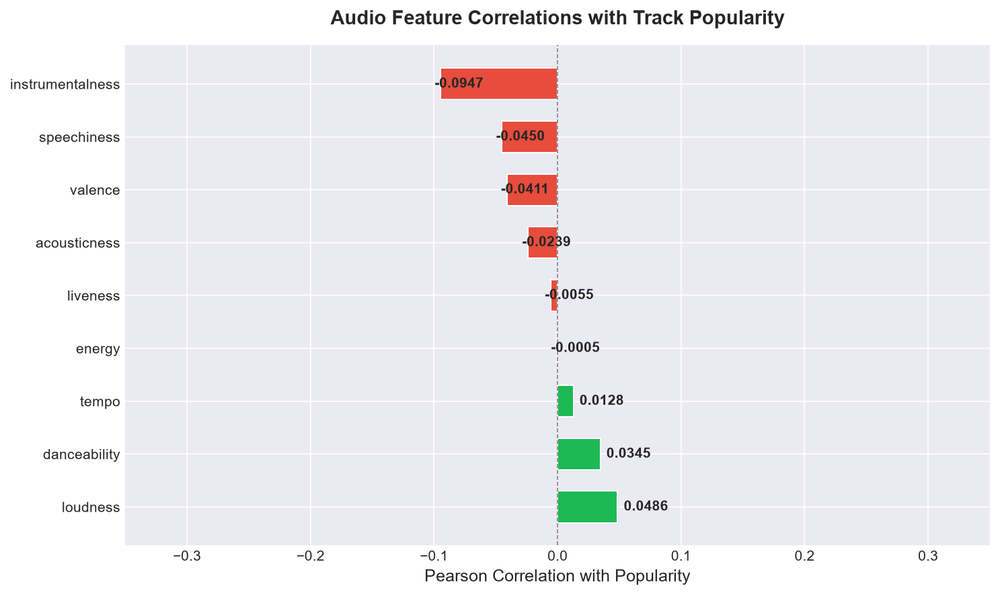
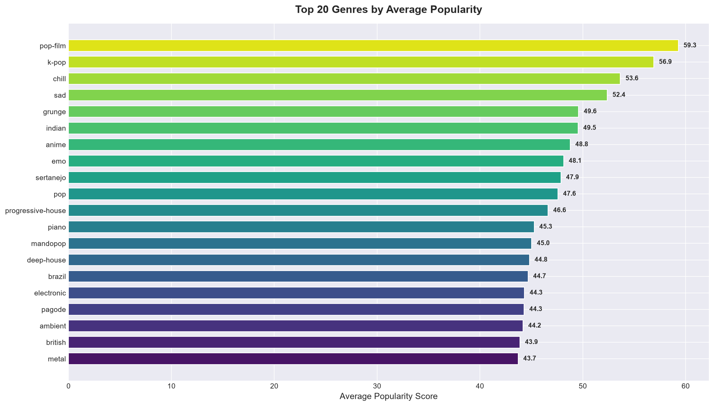
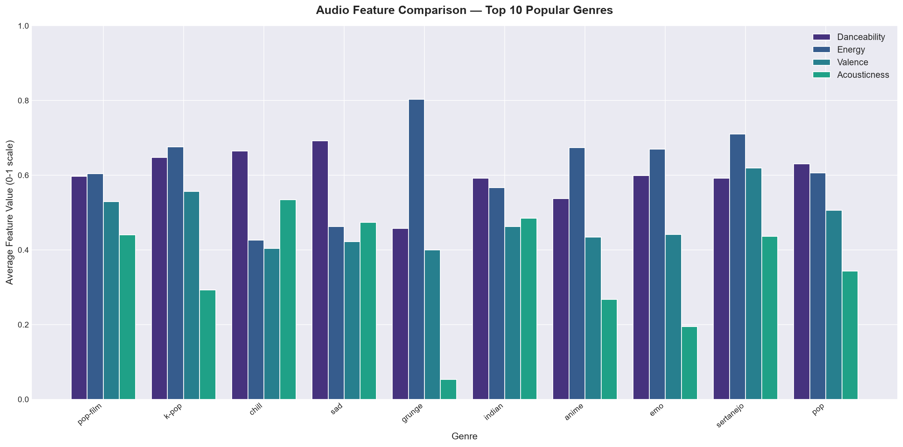
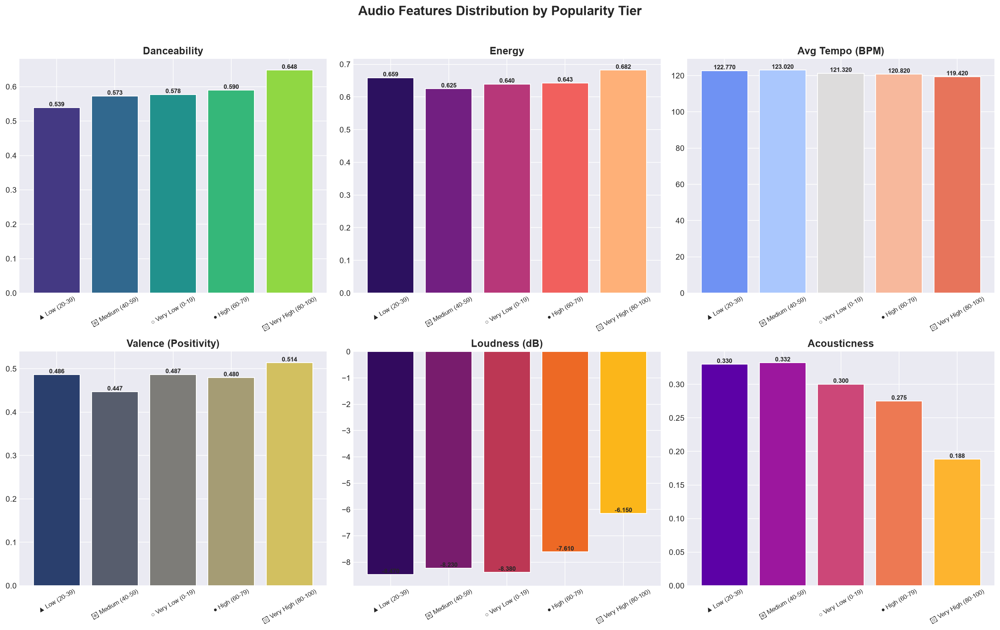
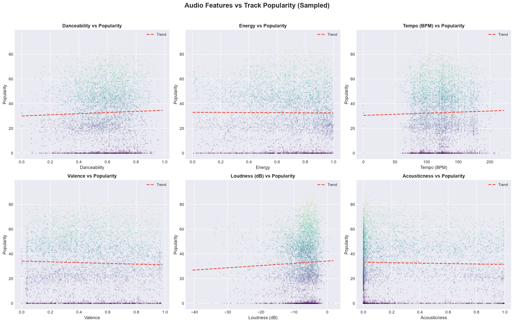

# 🎵 Spotify Tracks — Big Data Analysis with PySpark

## Project Overview

This is a **Big Data Analytics Mini Project** that analyzes the Spotify Tracks Dataset (~114,000 tracks) using **Apache Spark (PySpark)** to uncover relationships between audio features and track popularity across 114+ music genres.

---

## Key Findings

- **Vocal Dominance**: Instrumentalness has the strongest negative correlation with popularity ($r = -0.095$), showing tracks with vocals perform significantly better.
- **Energy & Danceability**: Tracks in the highest popularity tier (80–100) have the highest danceability (avg **0.648**) and energy (avg **0.682**).
- **Loudness Advantage**: Loudness is positively correlated with popularity ($r = +0.049$).
- **Top Genre by Popularity**: `pop-film` (avg popularity: 59.3), followed by `k-pop` (56.9), `chill` (53.7), and `sad` (52.4).
- **Genre Extremes**:
  - **Most Danceable**: `kids` (avg 0.779)
  - **Most Energetic**: `death-metal` (avg 0.932)
  - **Fastest Tempo**: `drum-and-bass` (avg 155.2 BPM)

---

## Objectives

1. **Feature-Popularity Correlation**: Analyze how audio features (danceability, energy, tempo, valence, loudness, acousticness) correlate with track popularity using Pearson correlation.
2. **Genre Comparison**: Compare audio feature distributions across 114+ music genres using Spark's distributed aggregation.
3. **Popularity Tier Analysis**: Bucket tracks into popularity tiers and examine feature patterns.
4. **Spark SQL Analytics**: Demonstrate big data SQL capabilities with window functions and complex aggregations.

---

## Technology Stack

| Component         | Technology                     |
|-------------------|--------------------------------|
| Processing Engine | Apache Spark 4.x (PySpark)     |
| Language          | Python 3.13                    |
| Visualization     | Matplotlib, Seaborn            |
| Machine Learning  | PySpark ML (VectorAssembler, Correlation) |
| SQL Engine        | Spark SQL                      |
| Data Format       | CSV → Spark DataFrame          |

---

## Project Structure

```
spotify-tracks/
├── .gitignore                      # Git ignore rules
├── requirements.txt                # Python dependencies
├── README.md                       # Project documentation & findings
├── spotify-tracks-dataset.csv      # Input dataset (~114K tracks)
├── spotify_bda_project.py          # Main PySpark analysis script
└── output_charts/                  # Generated visualizations
    ├── 01_correlation_heatmap.png
    ├── 02_popularity_correlations_bar.png
    ├── 03_top20_genres_popularity.png
    ├── 04_bottom20_genres_popularity.png
    ├── 05_genre_feature_comparison.png
    ├── 06_genre_tempo_comparison.png
    ├── 07_popularity_tier_features.png
    ├── 08_feature_vs_popularity_scatter.png
    ├── 09_genre_feature_heatmap.png
    └── 10_genre_boxplots.png
```

---

## Visualizations Preview

| Correlation Heatmap | Popularity Correlations |
|:---:|:---:|
|  |  |

| Top 20 Genres by Popularity | Audio Features Across Genres |
|:---:|:---:|
|  |  |

| Popularity Tier Distribution | Feature Scatter vs Popularity |
|:---:|:---:|
|  |  |

---

## How to Run

### 1. Install Dependencies
```bash
pip install -r requirements.txt
```

### 2. Run the Analysis
```bash
python spotify_bda_project.py
```

---

## Analysis Pipeline

1. **Data Loading**: Ingest CSV into Spark DataFrame with schema inference and distributed partitioning.
2. **Data Cleaning**: Handle malformed rows safely using `try_cast` expressions and drop null values.
3. **Descriptive Statistics**: Compute distributed statistical summaries (`describe()`) on large-scale data.
4. **Correlation Analysis**: Compute Pearson correlation matrix across audio features using PySpark ML's `VectorAssembler` and `Correlation`.
5. **Genre Comparison**: Aggregate audio metrics by genre via distributed `groupBy`.
6. **Popularity Bucketing**: Segment tracks into popularity tiers and evaluate feature shifts.
7. **Scatter Visualization**: Sample distributed data points to evaluate feature-popularity trends.
8. **Genre Heatmap & Boxplots**: Normalize metrics and evaluate distribution spreads per genre.
9. **Spark SQL Engine**: Execute SQL queries demonstrating filtering, multi-metric grouping, and window functions (`DENSE_RANK()`).

---

## Big Data Techniques Used

- **Distributed Computing**: Spark's `local[*]` execution mode leveraging all available CPU cores.
- **In-Memory Caching**: DataFrame persistence using `df.cache()` to optimize multi-pass operations.
- **DAG & Catalyst Optimization**: Execution planning with lazy evaluation and Catalyst query optimizer.
- **PySpark ML Vectorization**: Feature engineering using `VectorAssembler` for distributed correlation matrices.
- **Window Functions**: Analytical ranking with `DENSE_RANK() OVER (...)` in Spark SQL.
- **Safe Type Casting**: `try_cast` to tolerate corrupted or misaligned records without failing executor tasks.
